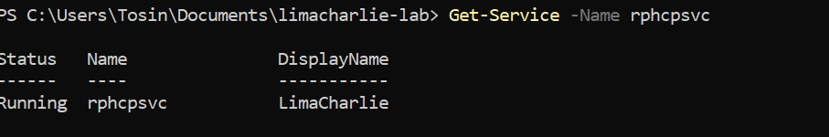
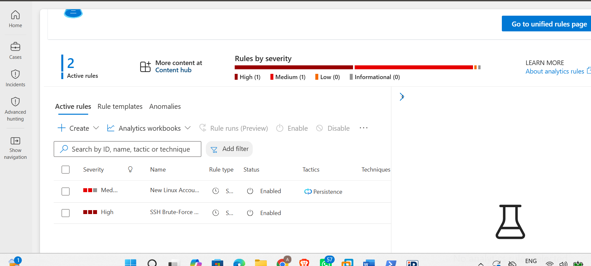
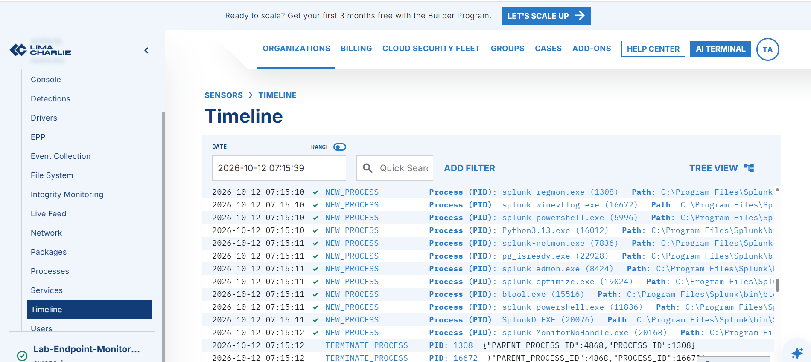
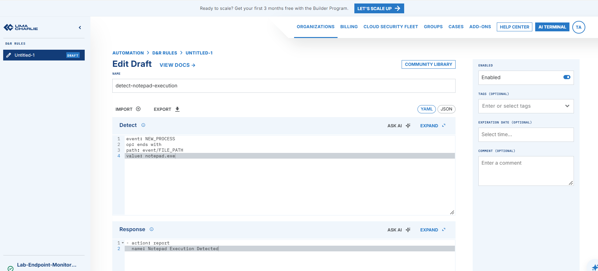
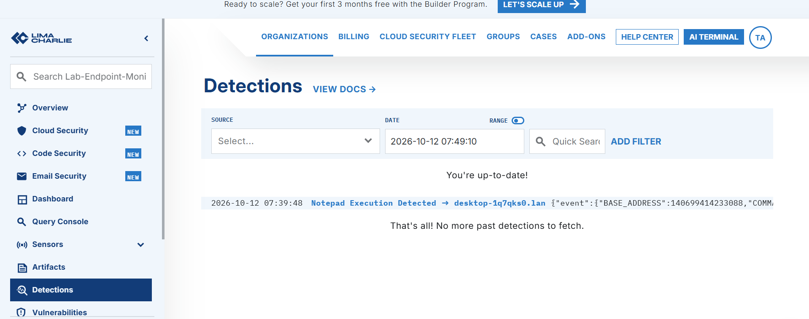

# LimaCharlie EDR Setup & Telemetry Analysis Lab

## Objective
This project demonstrates the deployment, configuration, and telemetry validation of the **LimaCharlie Endpoint Detection and Response (EDR)** agent on a Windows host. The goal is to capture live process creation telemetry, emulate adversary behavior via Atomic Red Team, and construct custom Detection & Response (D&R) rules for Threat Hunting and SOC monitoring.

---

## System Architecture & Details

+---------------------------------+                     +------------------------+                     +-----------------------+                     +-------------------+
| Windows 10 Workstation          |                     |                        |                     |                       |                     | SOC Analyst /     |
| (desktop-1q7qks0.lan)           |---Process Telemetry-->| LimaCharlie EDR Cloud  |---D&R Rules & Alerts->| Microsoft Sentinel    |---Merged PR Rules-->| GitHub Repo       |
| Running rphcpsvc service        |                     |                        |                     | (KQL Analytics)       |                     | (limacharlie-lab) |
+---------------------------------+                     +------------------------+                     +-----------------------+                     +-------------------+

* **Cloud Infrastructure:** Azure Resource Group `rg-livefire-soc` (`vm-win-01`, `vm-linux-01`)
* **SIEM / Analytics:** Microsoft Sentinel (KQL)
* **EDR Agent:** LimaCharlie EDR (`rphcpsvc` Windows service)
* **Adversary Emulation:** Atomic Red Team (`T1087.001`, `T1547.001`)
* **Repository:** `ARIBISALAT/limacharlie-lab`

---

## 🛡️ Proof Artifacts & Implementation Details

### 1. Endpoint Detection & Response (EDR) Agent Installation
Deployed and registered the LimaCharlie EDR sensor on `vm-win-01`. Sensor status verified active (`is_online is true`) on host `desktop-1q7qks0.lan`.

### 2. Active Analytics & Detection Rules Configuration
Configured active analytics rules to monitor endpoint process creation events and generate actionable telemetry alerts.

### 3. Live Process Telemetry Ingestion
Verified real-time process execution lineage and command-line arguments stream directly into the LimaCharlie cloud console.

### 4. Custom D&R Rule Construction
Authored custom Detection & Response rules in the rule editor to trigger response actions upon detecting malicious PowerShell behavior.

### 5. Detection Alert Trigger & Incident Response
Executed adversary emulation commands via Atomic Red Team, successfully firing automated detection alerts in the SOC dashboard.

---

## 🔍 Key Findings & Triage Notes
* **SIEM Logging Dependency:** Microsoft Sentinel requires an explicit Data Collection Rule (DCR) configured on the Azure Monitor Agent (AMA) to ingest Windows `SecurityEvent` Event ID 4688 (Process Creation) logs into the Workspace.
* **EDR Redundancy:** Continuous process lineage and command-line execution arguments were captured independently at the EDR layer via LimaCharlie, ensuring uninterrupted threat visibility even when SIEM log forwarders experience configuration gaps.
